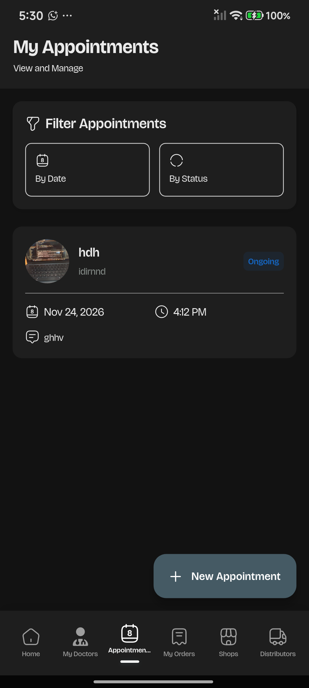

# Medorica ERP — Medical Representative App

The Medorica ERP Medical Representative (MR) mobile application is a cross-platform Flutter client for managing day-to-day pharmaceutical sales activities. It provides medical representatives with tools for attendance, doctor and chemist networks, appointments, orders, monthly plans and targets, notifications, gifts, team information, profiles, visual advertisements, and app updates.

> App package name: `mr_app`
>
> Current version: `1.0.0+106`
>
> Primary platforms: Android, iOS, web, Windows, macOS, and Linux

## Table of Contents

- [Features](#features)
- [Application Preview](#application-preview)
- [Technology Stack](#technology-stack)
- [Requirements](#requirements)
- [Project Setup](#project-setup)
- [Backend Configuration](#backend-configuration)
- [Running the Application](#running-the-application)
- [Building the Application](#building-the-application)
- [Project Structure](#project-structure)
- [Architecture](#architecture)
- [Testing and Quality Checks](#testing-and-quality-checks)
- [App Updates](#app-updates)
- [Platform Configuration Notes](#platform-configuration-notes)
- [Troubleshooting](#troubleshooting)
- [Contributing](#contributing)

## Features

### Authentication and Profile

- Secure MR login
- Splash and session initialization
- MR profile viewing and editing
- Local session state through `SharedPreferences`
- Logout and application exit handling

### Home Dashboard

- Personalized greeting
- Attendance status
- Monthly plan and target summaries
- Visual advertisement carousel
- Quick action navigation
- Bottom navigation for frequently used modules

### Doctor Network

- Browse and search doctors
- Create and edit doctor records
- View doctor details, experience, qualifications, specialties, chambers, and contact information

### Chemist Network

- Manage chemist shop records
- Search and filter chemist shops
- View and update shop details
- Manage chemist contact and description information

### Appointments

- View, filter, create, edit, and manage appointments
- Filter appointments by date or status
- Open an appointment detail sheet
- Schedule appointments directly from a doctor context

### Orders

- Create, edit, view, and delete orders
- Search and filter order records
- Review order details
- Manage selected products and order information

### Distributor Management

- Browse distributors
- Search and filter distributors
- View distributor contact, description, and order information
- Open distributor detail screens

### Attendance

- Submit attendance records
- Review attendance history
- View attendance reports in a calendar interface

### Monthly Planning and Targets

- View monthly plans
- Filter plans by date
- Review monthly target progress

### Gifts

- Browse the available gift inventory
- Create and edit gift applications
- Filter gifts and review request details

### Team, Notifications, and Content

- View team members and member details
- Receive and open MR notifications
- Read About Us information
- View visual advertisements
- Download salary slips

### Application Updates

- Checks a backend update endpoint at startup
- Compares the installed build number with the latest APK build number
- Displays an update screen when a newer Android build is available

## Application Preview

The existing application image demonstrates the appointment module interface:



Additional assets are stored in:

- [`assets/logo/`](assets/logo/)
- [`assets/images/`](assets/images/)
- [`assets/fonts/`](assets/fonts/)

## Technology Stack

| Area | Technology |
|---|---|
| Framework | Flutter |
| Language | Dart |
| State management | Flutter Riverpod |
| Routing | GoRouter |
| HTTP/API | Dio and `pretty_dio_logger` |
| Local persistence | SharedPreferences |
| UI components | Material, Cupertino Icons, Iconsax, Font Awesome |
| Calendar | TableCalendar |
| Date formatting | intl |
| Media selection | image_picker |
| File storage | path_provider |
| File opening | open_filex |
| Device/app information | package_info_plus |
| APK installation | flutter_app_installer |
| Testing | flutter_test |

## Requirements

Install the following before starting:

- Flutter SDK in the stable channel
- Dart SDK compatible with the project constraint: `^3.11.0`
- Android Studio or VS Code
- Android SDK and Android Studio SDK tools for Android builds
- Xcode and CocoaPods for iOS or macOS builds
- A running Medorica ERP backend API
- Chrome or another supported browser for web builds

Check the local installation:

```bash
flutter --version
flutter doctor
dart --version
```

## Project Setup

1. Clone the repository:

   ```bash
   git clone https://github.com/naiyo-24/MEDORICA-ERP-MR-APP.git
   cd MEDORICA-ERP-MR-APP
   ```

2. Install Flutter packages:

   ```bash
   flutter pub get
   ```

3. Connect a physical device or start an emulator:

   ```bash
   flutter devices
   ```

4. Configure the API base URL for the backend.

5. Run the application:

   ```bash
   flutter run
   ```

For iOS dependencies, CocoaPods must be available:

```bash
cd ios
pod install
cd ..
```

## Backend Configuration

API endpoints and the default base URL are centralized in [`lib/services/api_url.dart`](lib/services/api_url.dart).

The default configured base URL is:

```text
http://192.168.0.152:8000
```

Override the base URL at run time with `--dart-define`:

```bash
# Android emulator connecting to a backend on the host machine
flutter run --dart-define=API_BASE_URL=http://10.0.2.2:8000

# Physical device on the same LAN
flutter run --dart-define=API_BASE_URL=http://<backend-lan-ip>:8000

# Production API
flutter run --dart-define=API_BASE_URL=https://api.example.com
```

The current implementation replaces `localhost` and `127.0.0.1` overrides with the configured LAN address, because loopback addresses generally do not point to the backend host from a physical device or Android emulator.

API modules include:

- MR login and profile
- App version and APK downloads
- Team and distributors
- Visual advertisements
- Monthly plans and targets
- Attendance
- Doctors
- Appointments
- Chemist shops
- Orders
- Notifications
- Gifts
- Salary slips

Use `ApiUrl.getFullUrl()` when a service needs a complete URL.

## Running the Application

Run with the default device:

```bash
flutter run
```

Run on a selected device:

```bash
flutter devices
flutter run -d <device-id>
```

Run in release mode:

```bash
flutter run --release
```

Run for a specific platform:

```bash
flutter run -d android
flutter run -d chrome
flutter run -d ios
flutter run -d macos
flutter run -d windows
flutter run -d linux
```

## Building the Application

### Android APK

```bash
flutter build apk --release
```

The APK is normally generated under:

```text
build/app/outputs/flutter-apk/app-release.apk
```

### Android App Bundle

```bash
flutter build appbundle --release
```

### iOS

```bash
flutter build ios --release
```

Xcode signing and a valid Apple developer account are required for device distribution.

### Web

```bash
flutter build web --release
```

### Desktop

```bash
flutter build macos --release
flutter build windows --release
flutter build linux --release
```

## Project Structure

```text
lib/
├── cards/          Reusable feature-specific cards and bottom sheets
├── models/         API/domain data models
├── notifiers/      Riverpod state classes and state transitions
├── provider/       Riverpod provider definitions
├── router/         GoRouter routes and route parameters
├── screens/        Application pages and feature screens
├── services/       Dio/API and platform service implementations
├── theme/          Light and dark application themes
├── widgets/        Shared widgets and application shell components
└── main.dart       App bootstrap, update check, and root configuration
assets/
├── fonts/          Custom application font
├── images/         General UI images
└── logo/           App logo and launcher icon source
test/
└── widget_test.dart Existing Flutter test entry point
android/            Android platform project
ios/                iOS platform project
web/                Web platform project
linux/              Linux platform project
macos/              macOS platform project
windows/            Windows platform project
```

## Architecture

The application follows a feature-oriented structure:

1. **Screens** provide pages and user interactions.
2. **Cards and widgets** encapsulate reusable visual components.
3. **Providers** expose application state and dependencies.
4. **Notifiers** contain feature state and state-change logic.
5. **Services** perform backend communication and platform operations.
6. **Models** represent API entities and parsed JSON data.
7. **AppRouter** centralizes navigation, nested routes, and route arguments.

The app uses Riverpod `ProviderScope`, while navigation is implemented with `GoRouter`. Feature state is generally organized through a provider plus notifier pair.

## Testing and Quality Checks

Install dependencies and run the analyzer:

```bash
flutter pub get
flutter analyze
```

Run the test suite:

```bash
flutter test
```

Format Dart source files:

```bash
dart format lib test
```

Generate or refresh app launcher icons:

```bash
dart run flutter_launcher_icons
```

### Test Status

The repository includes a starter widget test, but its counter-based assertions do not match the current application. Replace or update the test with real application, provider, router, or service tests when validating changes.

## App Updates

At startup, [`lib/main.dart`](lib/main.dart) requests the latest-version metadata from the backend. Android update files are expected to include a build number in the APK filename, for example:

```text
medorica_106.apk
```

The app extracts the numeric build suffix and compares it with `PackageInfo.buildNumber`. If the values differ, it displays [`lib/widgets/app_update_screen.dart`](lib/widgets/app_update_screen.dart).

Update endpoints are defined in `ApiUrl` under:

- `/mr-app-updates/versions`
- `/mr-app-updates/latest-version`
- `/mr-app-updates/download-latest`
- `/mr-app-updates/download/<filename>`

## Platform Configuration Notes

### Android

- Java compatibility is configured for Java 17.
- The Gradle project currently uses placeholder package settings:
  - Namespace: `com.example.mr_app`
  - Application ID: `com.example.mr_app`
- Android release builds currently use the debug signing configuration. Configure a production keystore before publishing.
- Verify Internet permission and provider/file configuration for APK downloads and file opening.

### iOS

- Xcode project signing must be configured before device or App Store deployment.
- CocoaPods dependencies are present in the repository, but regenerate them when dependencies change.
- Confirm image, camera, file, and network usage descriptions in [`ios/Runner/Info.plist`](ios/Runner/Info.plist).

### Web and Desktop

- Device-specific plugins may have limited support or require platform-specific configuration.
- Image picking, file opening, URL launching, and APK installation may differ by platform.

## Troubleshooting

### Packages fail to resolve

```bash
flutter clean
flutter pub get
```

### Android emulator cannot reach the backend

Use `10.0.2.2` in place of `localhost`:

```bash
flutter run --dart-define=API_BASE_URL=http://10.0.2.2:8000
```

### Physical device cannot reach the backend

- Put the device and backend server on the same network.
- Replace the base URL with the backend machine's LAN IP.
- Allow the backend port through any firewall.
- Do not use `localhost` or `127.0.0.1`.

### iOS dependency errors

```bash
cd ios
pod deintegrate
pod install
cd ..
flutter clean
flutter pub get
```

### Android build or Gradle errors

```bash
flutter clean
cd android
./gradlew clean
cd ..
flutter pub get
flutter run
```

### Network/cleartext HTTP errors

Android and iOS platform security settings may block plain HTTP APIs. Use HTTPS for production or explicitly configure development-only cleartext/network security exceptions.

### App update check blocks startup

The startup update check catches backend and package-info failures and continues normally unless a valid newer build number is returned. On unreliable networks, verify that the update endpoints and APK filename format are reachable and consistent.

## Contributing

1. Create a focused feature or fix branch.
2. Follow the existing feature structure: model, service, notifier/provider, card/widget, and screen.
3. Keep API URLs in `ApiUrl` and use environment overrides for environment-specific hosts.
4. Format Dart files before submitting:

   ```bash
   dart format lib test
   ```

5. Run static analysis and tests:

   ```bash
   flutter analyze
   flutter test
   ```

6. Test API-dependent flows against a reachable backend.
7. Add or update widget tests for behavior changes.
8. Open a pull request with a summary, test evidence, and relevant screenshots.
